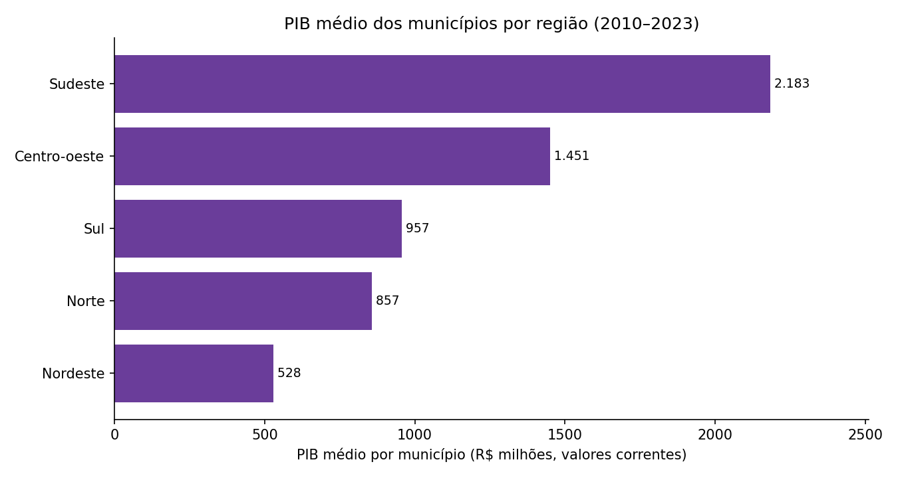
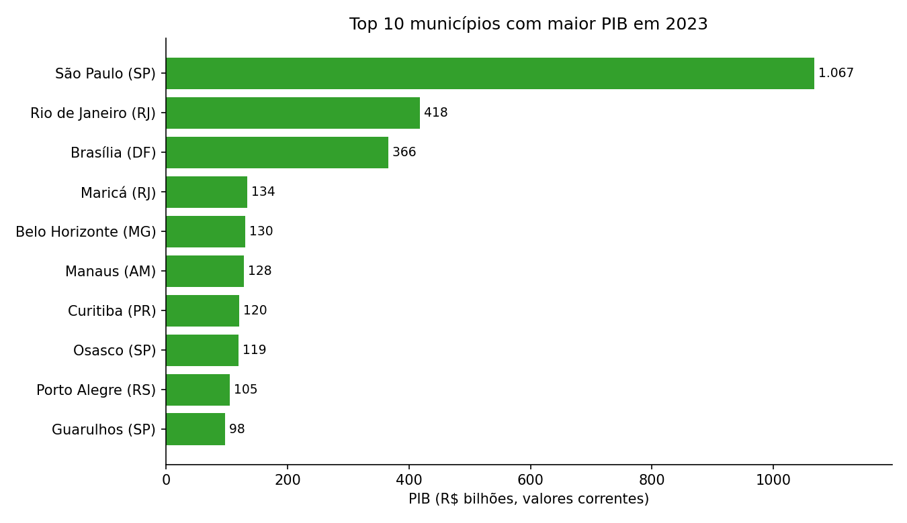
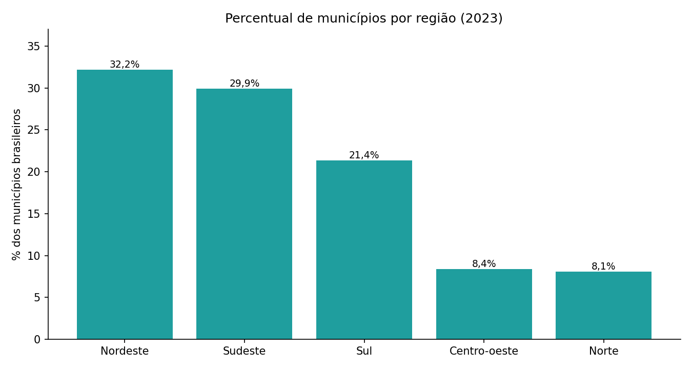
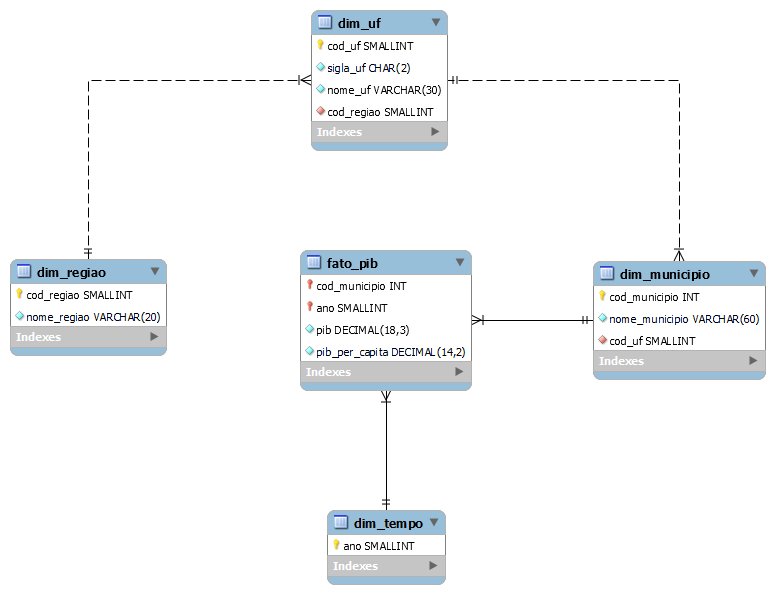

# Análise do PIB dos Municípios Brasileiros (2010–2023)

Projeto acadêmico de Business Intelligence desenvolvido para a disciplina **Laboratório de Inovação IV**, ministrada pelo Prof. Edilberto Silva.

## 🎯 Sobre o projeto

O objetivo deste projeto é analisar como o PIB dos municípios brasileiros evoluiu entre 2010 e 2023, comparando municípios, estados e regiões, utilizando a base de dados oficial do IBGE.

**Pergunta-chave:**
> Como o Produto Interno Bruto dos municípios brasileiros evoluiu entre 2010 e 2023 e quais municípios, estados e regiões apresentaram os maiores valores de PIB e PIB per capita?

## 👥 Equipe

| Nome | E-mail |
| :---- | :---- |
| Daniel Reis Rodrigues | danielreisrodrigues15@gmail.com |
| Caio Nunes Lima | caionunes123@gmail.com |

## 📊 Fonte de dados

- **IBGE — PIB dos Municípios (2010–2023)**
  Página oficial: https://www.ibge.gov.br/estatisticas/economicas/contas-nacionais/9088-produto-interno-bruto-dos-municipios.html
  Base utilizada: `PIB dos Municípios - base de dados 2010-2023.xlsx` (77.965 registros, 43 campos)

> ⚠️ Para os anos de 2022 e 2023, o IBGE disponibilizou apenas o PIB e o PIB per capita (sem os dados por setor econômico).

## 📈 Primeiros resultados da análise exploratória

Valores em reais correntes (sem descontar a inflação). Os gráficos foram feitos com a base do IBGE na Fase 2.







## 🧩 Modelo multidimensional

A base do IBGE foi separada em 1 tabela fato (`fato_pib`) e 4 dimensões (`dim_regiao`, `dim_uf`, `dim_municipio` e `dim_tempo`). O diagrama foi exportado do MySQL Workbench, e o script de criação está em `database/ddl/`.



## 📁 Estrutura do repositório

```
projeto-bi-pib-municipios/
├── README.md
├── docs/
│   ├── crisp-dm/          ← Fases do projeto (CRISP-DM)
│   ├── arquitetura/       ← Modelo multidimensional (PNG e MWB)
│   └── imagens/           ← Gráficos usados no README
├── database/
│   ├── ddl/               ← Scripts DDL (MMD e staging)
│   ├── etl/               ← Scripts SQL de carga das dimensões e da fato
│   └── dumps/             ← Dumps dos bancos (staging e MMD)
├── python/                ← Scripts Python do ETL (veja python/README.md)
├── dados/                 ← Base do IBGE (xlsx) e CSVs em dados/csv/
└── power-bi/              ← Dashboard (quando estiver pronto)
```

## 📌 Fases do projeto

- [x] Fase 0 — Perguntas-chave (`docs/crisp-dm/00-perguntas-chave.md`)
- [x] Fase 1 — Entendimento do negócio
- [x] Fase 2 — Entendimento dos dados
- [ ] Fase 3 — Preparação dos dados
- [ ] Fase 4 — Modelagem
- [ ] Fase 5 — Avaliação
- [ ] Fase 6 — Implantação (Deployment)
